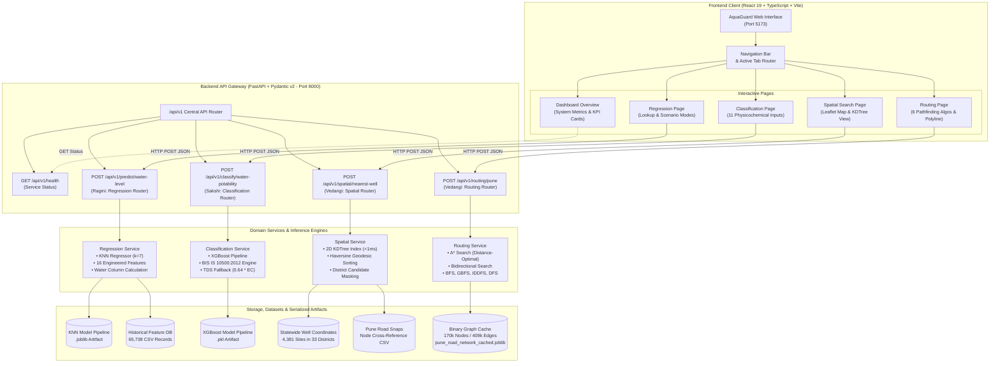

<div align="center">

# 💧 AquaGuard AI

### *Groundwater Intelligence & Potability Decision-Support System*

An integrated geospatial intelligence and machine learning platform engineered to assess groundwater depletion, forecast aquifer table depths, evaluate drinking water potability against national standards, and execute directed road network pathfinding for emergency water distribution.

<br />


<br />

[Quick Links](#quick-links) • [Project Overview](#project-overview) • [Core Modules](#core-modules) • [Main Features](#main-features) • [Tech Stack](#technology-stack) • [System Architecture](#system-architecture) • [Project Structure](#project-structure) • [Installation & Setup](#installation-and-setup) • [API Documentation](#api-documentation) • [Screenshots](#screenshots) • [Contributors](#contributors) • [Future Scope](#future-scope) • [License](#license)

---

</div>

<a id="quick-links"></a>
## 📌 Quick Links

- **Repository**: [https://github.com/Ragini-telange/AquaGuard-AI.git](https://github.com/Ragini-telange/AquaGuard-AI.git)
- **Interactive API Docs (Swagger UI)**: [http://localhost:8000/docs](http://localhost:8000/docs)
- **ReDoc Documentation**: [http://localhost:8000/redoc](http://localhost:8000/redoc)
- **System Health Endpoint**: [http://localhost:8000/api/v1/health](http://localhost:8000/api/v1/health)
- **Frontend Dashboard**: [http://localhost:5173](http://localhost:5173)
- **Setup Guide**: Jump to [Installation and Setup](#installation-and-setup)
- **Architecture Flow**: Jump to [System Architecture](#system-architecture)

---

<a id="project-overview"></a>
## 🎯 Project Overview

Groundwater depletion, erratic monsoon precipitation, and industrial or agricultural contamination represent urgent challenges for water resource managers and agrarian communities across Maharashtra, India. Decision-makers often lack unified tools to anticipate water table decline, inspect water potability before human consumption, locate functional monitoring wells, and coordinate ground distribution logistics.

**AquaGuard AI** solves this by unifying four specialized engineering domains into a single decision-support platform:

```
┌──────────────────────────────────────────────────────────────────────────────┐
│                              AQUAGUARD AI PLATFORM                           │
├─────────────────────┬─────────────────────┬───────────────────┬──────────────┤
│      MODULE 1       │      MODULE 2       │     MODULE 3      │   MODULE 4   │
│  Groundwater Level  │    Water Quality    │   Nearest Well    │ Road Routing │
│     Regression      │   Classification    │  Spatial Search   │ Pathfinding  │
│                     │                     │                   │              │
│  KNN Regressor      │  XGBoost Classifier │  2D KDTree Index  │  6 Graph     │
│  (k=7, Weighted)    │  + BIS IS 10500     │  + Haversine      │  Search      │
│  Depth in m bgl     │  Potability Verdict │  4,381 Well Sites │  Algorithms  │
└─────────────────────┴─────────────────────┴───────────────────┴──────────────┘
```

### How the Four Modules Work Together

1. **Hydrological Forecasting**: Environmental planners monitor well stations and forecast future depth to the groundwater table (`m bgl`) based on antecedent rainfall and autoregressive lag readings.
2. **Potability Verification**: When extracting groundwater, water technicians input laboratory or on-site physicochemical parameters to evaluate whether the sample is safe for consumption and check compliance against Indian Standard limits.
3. **Geospatial Discovery**: When local supply wells fail or run dry, the spatial search engine instantly discovers the nearest verified well stations across all 33 Maharashtra districts in sub-millisecond query time.
4. **Logistics & Emergency Routing**: Supply tankers and maintenance vehicles leverage directed road network pathfinding on the 170,253-node Pune road network to plan optimal transport routes respecting one-way streets and real turn restrictions.

---

<a id="core-modules"></a>
## 🔬 Core Modules

AquaGuard AI is structured into four domain modules developed through collaborative research:

### 💧 Module 1: Groundwater Level Prediction
*Developed by **Ragini Telange***

- **Algorithm**: **$K$-Nearest Neighbors Regressor ($k=7$)** with distance-weighted interpolation (`weights='distance'`) encapsulated in a scikit-learn pipeline featuring median imputation, standard scaling, and one-hot categorical encoding.
- **Target Variable**: Depth to water table in **metres below ground level ($\text{m bgl}$)**.
  - **Hydrological Interpretation**: A **larger positive value** indicates a **deeper water table** (depleted aquifer, water is farther from the surface). A **smaller positive value** indicates a **shallower water table** (recharged aquifer, water is closer to the surface).
  - **Effective Water Column**: Automatically calculated as $\text{Well Depth (m)} - \text{Predicted Water Level (m bgl)}$.
- **Data Foundation**:
  - Central Ground Water Board (CGWB) quarterly monitoring dataset (1970–2025, 631,973 clean records across 4,558 wells).
  - High-resolution daily precipitation dataset (2021–2025, 121,904 readings across 658 stations in Maharashtra).
  - Integrated Experiment B dataset: 65,738 chronologically aligned records (2021–2025) across 3,737 monitored well stations.
- **16 Input Features (Strictly Past-Only to Prevent Data Leakage)**:
  - *Autoregressive Lags*: $\text{Lag}_1$ ($t-1$), $\text{Lag}_2$ ($t-2$), $\text{Lag}_4$ ($t-4 \approx 1\text{ year prior}$).
  - *Past Rolling Statistics*: $\text{Past\_Rolling\_Mean}_3$, $\text{Past\_Rolling\_Std}_3$ (shifted by 1 period).
  - *Antecedent Rainfall*: Cumulative district rainfall over preceding windows: $\text{Rain\_Prior\_30d}$, $\text{Rain\_Prior\_60d}$, $\text{Rain\_Prior\_90d}$, $\text{Rain\_Prior\_180d}$.
  - *Cyclical Time Encoding*: $\text{Month\_Sin} = \sin(2\pi \cdot m / 12)$, $\text{Month\_Cos} = \cos(2\pi \cdot m / 12)$.
  - *Metadata & Spatial Coordinates*: $\text{Well Depth (m)}$, $\text{Latitude}$, $\text{Longitude}$, $\text{Season}$, $\text{District Name}$.
- **Verified Holdout Performance (2024–2025 Test Benchmark)**:
  - **$R^2$ Score**: **0.7766**
  - **Root Mean Squared Error (RMSE)**: **1.9295 m**
  - **Mean Absolute Error (MAE)**: **1.3247 m**
  - *TimeSeriesSplit 5-Fold Cross-Validation*: Mean $R^2 = 0.7110$, Mean $\text{RMSE} = 1.9066\text{ m}$ (Decisive winner across all expanding time-series folds).
- **Dual Execution Modes**:
  1. *Historical Well Lookup*: Select from 3,737 pre-indexed CGWB wells to retrieve actual lagged readings and antecedent rainfall.
  2. *Custom Hydrological Scenario*: Evaluate custom or hypothetical water table scenarios.
  - *Integrity Safeguard*: Historical actual values and prediction errors are strictly suppressed when no real ground observation exists for a custom date or scenario.

---

### 🧪 Module 2: Water Quality Potability Classification
*Developed by **Sakshi***

- **Algorithm**: **XGBoost Classifier** trained on multi-parameter water chemistry samples.
- **Classification Objective**: Binary prediction of drinking water suitability:
  - **Class 0**: **Non-Potable** (Unsafe for direct human consumption).
  - **Class 1**: **Potable** (Compliant with baseline drinking water safety metrics).
- **11 Physicochemical Input Parameters**:
  - pH, Electrical Conductivity (EC in $\mu\text{S/cm}$), Total Dissolved Solids (TDS in $\text{mg/L}$), Total Hardness ($\text{mg/L}$ as $\text{CaCO}_3$), Calcium ($\text{Ca}^{2+}$), Magnesium ($\text{Mg}^{2+}$), Chloride ($\text{Cl}^{-}$), Sulphate ($\text{SO}_4^{2-}$), Dissolved Iron ($\text{Fe}$), Bicarbonate ($\text{HCO}_3^{-}$), and Sodium ($\text{Na}^{+}$).
- **Domain Fallback Estimation**:
  - When laboratory TDS measurements are unavailable, the backend automatically computes:
    $$\text{TDS} = 0.64 \times \text{Electrical Conductivity (EC)}$$
- **Bureau of Indian Standards (BIS IS 10500:2012) Compliance Engine**:
  - The system cross-references parameters against national permissible limits:
    - $\text{pH}$: $6.5 - 8.5$
    - $\text{TDS}$: $\le 500\text{ mg/L}$
    - $\text{Total Hardness}$: $\le 200\text{ mg/L}$
    - $\text{Calcium}$: $\le 75\text{ mg/L}$
    - $\text{Magnesium}$: $\le 30\text{ mg/L}$
    - $\text{Chloride}$: $\le 250\text{ mg/L}$
    - $\text{Sulphate}$: $\le 200\text{ mg/L}$
    - $\text{Dissolved Iron}$: $\le 1.0\text{ mg/L}$
  - Generates an itemized audit of limit exceedances with explicit numeric deltas.
- **Scientific Integrity & Regulatory Advisory**:
  > [!IMPORTANT]
  > **Official Advisory Notice**: Machine learning classifications reflect statistical modeling of physicochemical features against BIS IS 10500:2012 limits. Machine learning inferences do not guarantee biological potability and never substitute for certified microbiological, virological, and heavy-metal toxicological laboratory assays.

---

### 📍 Module 3: Nearest Well Spatial Search
*Developed by **Vedangi***

- **Geospatial Coverage**: **4,381 distinct groundwater well sites** spanning all **33 districts** of Maharashtra.
- **Indexing Structure**: 2D **$k$-d Tree (`scipy.spatial.KDTree`)** built over geographic coordinates $(\text{Latitude}, \text{Longitude})$ enabling $< 1\text{ ms}$ candidate neighbor retrieval.
- **Geodesic Distance**: Strict calculation using the spherical **Haversine formula** ($R = 6,371\text{ km}$):
  $$a = \sin^2\left(\frac{\Delta\phi}{2}\right) + \cos(\phi_1)\cos(\phi_2)\sin^2\left(\frac{\Delta\lambda}{2}\right), \quad d = 2R \cdot \text{atan2}(\sqrt{a}, \sqrt{1-a})$$
- **District-Level Filtering**: Search globally across Maharashtra or restrict queries to specific administrative boundaries (e.g., Pune, Wardha, Solapur, Nagpur).
- **Road Network Snapping**: Pune district wells are pre-snapped to their nearest OpenStreetMap road network node ID with recorded snap distances ($\text{m}$), providing a bridge into Module 4 routing.

---

### 🛣️ Module 4: Directed Road Network Pathfinding
*Developed by **Vedangi***

- **Network Topology**: Directed OpenStreetMap road network of Pune District represented as a **NetworkX `MultiDiGraph`**.
  - **Graph Scale**: **170,253 nodes** and **409,399 directed edges**.
  - **Edge Weighting**: Real road segment lengths measured in metres ($\text{m}$).
  - **One-Way Directed Flow**: Pathfinding strictly respects directional flow and turn restrictions.
- **Binary Graph Cache**:
  - Raw XML GraphML (`199.50 MB`) is pre-parsed and serialized into a compressed binary joblib cache (`10.17 MB`), reducing backend cold-start load time from **28.6 seconds to 7.0 seconds** (4.1x speedup).
- **Six Implemented Search Algorithms**:
  1. **A\* Search**: Distance-optimal pathfinding combining accumulated edge cost $g(n)$ with Euclidean distance heuristic $h(n)$ to the destination node.
  2. **Bidirectional Search**: Explores simultaneously from source (successors) and destination (predecessors), finding hop-optimal routes with significantly reduced node expansion.
  3. **Breadth-First Search (BFS)**: Unweighted benchmark exploring uniformly level-by-level to guarantee the minimum number of road hops (edges).
  4. **Greedy Best-First Search (GBFS)**: Heuristic-driven search prioritizing nodes solely by straight-line Euclidean distance to the target.
  5. **Iterative Deepening DFS (IDDFS)**: Memory-efficient search combining DFS space complexity with BFS completeness by incrementally deepening depth bounds ($d \le 25$).
  6. **Depth-First Search (DFS)**: Uninformed baseline exploring deep trajectories along the graph before backtracking.
- **Benchmark Route Parity (Pair 1: Sarati Local Hop `12788595845` $\rightarrow$ `12788595830`)**:
  - **A\* Distance**: **$227.06\text{ m}$** (5 edges, optimal road distance)
  - **BFS Distance**: **$237.65\text{ m}$** (3 edges, minimum edge count)
- **Geometry Generation**: Returns ordered $[\text{lat}, \text{lon}]$ coordinate pairs for interactive Leaflet polyline rendering.

---

<a id="main-features"></a>
## 🚀 Main Features

| Icon | Feature | Technical Implementation | Module Owner |
|:---:|:---|:---|:---:|
| 📈 | **Groundwater Level Forecasting** | Distance-weighted KNN Regressor ($k=7$) evaluating 16 temporal, spatial, and antecedent rainfall features. Dual modes: Historical Lookup & Scenario Simulation. | **Ragini** |
| 🪣 | **Effective Water Column Calculation** | Computes remaining usable aquifer column ($\text{Well Depth} - \text{Predicted Depth}$) in metres. | **Ragini** |
| 🧪 | **Water Potability Classification** | XGBoost binary classifier (0 = Non-Potable, 1 = Potable) evaluating 11 chemical ion concentrations with class probability scores. | **Sakshi** |
| ⚖️ | **BIS IS 10500:2012 Compliance** | Automated standards engine checking 8 critical water safety parameters against acceptable limits with itemized exceedance reports. | **Sakshi** |
| ⚡ | **Automatic TDS Estimation** | Domain fallback estimating Total Dissolved Solids as $\text{TDS} = 0.64 \times \text{EC}$ when laboratory measurements are omitted. | **Sakshi** |
| 📍 | **Statewide Well Discovery** | 2D $k\text{-d Tree}$ spatial search indexing 4,381 well locations across 33 Maharashtra districts with Haversine spherical distance sorting. | **Vedangi** |
| 🗺️ | **Administrative District Filtering** | Query candidate wells statewide or isolate searches to specific districts (e.g., Pune, Wardha, Solapur). | **Vedangi** |
| 🛣️ | **Pune Road Network Routing** | Directed pathfinding over 170,253 nodes and 409,399 OSM edges with 6 search algorithms (A\*, Bidirectional, BFS, GBFS, IDDFS, DFS). | **Vedangi** |
| ⚡ | **Binary Graph Acceleration** | 10.17 MB compressed binary graph cache enabling 7.0-second cold start (4.1x faster than raw XML GraphML parsing). | **Vedangi** |
| 🗺️ | **Interactive Leaflet Cartography** | Dynamic map viewports with custom SVG well markers, route polylines, start/destination pins, and tile caching. | **System** |
| 🩺 | **System Health & Lifespan Loader** | FastAPI asynchronous lifespan pre-loading all models, datasets, and graph caches at startup with live status diagnostics. | **System** |

---

<a id="technology-stack"></a>
## 🛠️ Technology Stack

### Frontend
- **Library**: [React 19.3](https://react.dev/) — Declarative component architecture
- **Language**: [TypeScript 5.x](https://www.typescriptlang.org/) — Strict static typing for API contracts and geospatial payloads
- **Build Tool**: [Vite 8.3](https://vitejs.dev/) — Fast Hot Module Replacement (HMR) and optimized ES bundle generation
- **Styling**: [Tailwind CSS v4](https://tailwindcss.com/) — Modern utility-first responsive styling
- **Icons**: [Lucide React](https://lucide.dev/) — Consistent iconography across dashboard panels
- **Mapping**: [Leaflet 1.9](https://leafletjs.com/) & [@types/leaflet](https://www.npmjs.com/package/@types/leaflet) — Interactive OpenStreetMap tile rendering, custom SVG marker layers, and polyline route paths
- **Code Quality**: [Oxlint](https://oxc.rs/) — High-speed JavaScript/TypeScript linter

### Backend
- **Framework**: [FastAPI 0.110+](https://fastapi.tiangolo.com/) — High-performance asynchronous Python REST API
- **ASGI Server**: [Uvicorn 0.29+](https://www.uvicorn.org/) — Lightning-fast ASGI production web server
- **Data Validation**: [Pydantic v2.7+](https://docs.pydantic.dev/) & [pydantic-settings](https://docs.pydantic.dev/latest/concepts/pydantic_settings/) — Strict request/response schema serialization and type safety
- **Configuration**: [python-dotenv](https://github.com/motdotla/dotenv) — Environment variable management

### Machine Learning & Data Processing
- **Model Training & Evaluation**: [Scikit-Learn 1.6.1](https://scikit-learn.org/) — Strictly pinned for serialization compatibility with trained pipeline artifacts
- **Gradient Boosting**: [XGBoost 2.0+](https://xgboost.readthedocs.io/) — Extreme Gradient Boosting for water potability classification
- **Data Manipulation**: [Pandas 2.2+](https://pandas.pydata.org/) — In-memory tabular processing, time-series alignment, and lookup indexing
- **Numerical Computing**: [NumPy 1.26+](https://numpy.org/) — Vectorized calculations, trigonometric cyclic encoding, and coordinate arrays
- **Spatial Indexing**: [SciPy 1.12+](https://scipy.org/) (`scipy.spatial.KDTree`) — Logarithmic-time nearest-neighbor coordinate spatial searches
- **Model Serialization**: [Joblib 1.4+](https://joblib.readthedocs.io/) — Pipeline unpickling and compressed binary graph caching

### Spatial Search, Routing & Network Graph
- **Graph Framework**: [NetworkX 3.2+](https://networkx.org/) — Directed multigraph modeling (`MultiDiGraph`)
- **Geographic Data**: [OpenStreetMap (OSM)](https://www.openstreetmap.org/) — Pune District road geometry (GraphML)
- **Spherical Geodesy**: Custom vectorized Haversine distance implementation

### Testing & Development
- **Testing**: [Pytest 8.0+](https://docs.pytest.org/) & [HTTPX 0.27+](https://www.python-httpx.org/) — End-to-end API integration test suite
- **Version Control**: [Git](https://git-scm.com/) & [GitHub](https://github.com/)

---

<a id="system-architecture"></a>
## 🏗️ System Architecture



### Architectural Highlights
- **Pre-Cached Lifespan Initialization**: Models, tabular indices, and the 170k-node graph cache load into memory once at FastAPI startup, guaranteeing deterministic sub-15ms response times for prediction and spatial queries.
- **Strict Domain Boundary Validation**: Routing is strictly bounded to the directed Pune road network graph, returning informative 404/422 status codes for nodes outside district boundaries.
- **Strict Data Integrity Safeguards**: The regression service suppresses actual historical measurements and error metrics whenever an arbitrary or scenario date lacks an actual monitoring record.

---

<a id="project-structure"></a>
## 📂 Project Structure

```text
AquaGuard-AI/
├── backend/                             # Production FastAPI Backend Application
│   ├── app/
│   │   ├── main.py                     # FastAPI application factory & lifespan startup loader
│   │   ├── api/
│   │   │   └── v1/
│   │   │       ├── api_router.py       # Central v1 endpoint router mounting all 4 sub-routers
│   │   │       └── endpoints/
│   │   │           ├── regression.py   # Ragini: /api/v1/predict/water-level endpoint
│   │   │           ├── classification.py # Sakshi: /api/v1/classify/water-potability endpoint
│   │   │           ├── spatial.py      # Vedangi: /api/v1/spatial/nearest-well endpoint
│   │   │           └── routing.py      # Vedangi: /api/v1/routing/pune pathfinding endpoint
│   │   ├── core/
│   │   │   └── config.py               # Pydantic BaseSettings & cross-platform path resolution
│   │   ├── schemas/                    # Pydantic v2 request & response validation models
│   │   │   ├── regression.py           # Request, response, and EvaluationContext models
│   │   │   ├── classification.py       # Request, response, and ExceededParameter models
│   │   │   ├── spatial.py              # Request, response, and WellLocationItem models
│   │   │   └── routing.py              # Request, response, and SearchAlgorithm enum
│   │   └── services/                   # Core business and machine learning inference logic
│   │       ├── regression_service.py   # KNN (k=7) predictor & 65k historical feature lookups
│   │       ├── classification_service.py # XGBoost classifier & BIS IS 10500:2012 check engine
│   │       ├── spatial_service.py      # 4,381 well locations index & KDTree Haversine search
│   │       └── routing_service.py      # 170k-node Pune OSM graph & 6 pathfinding algorithms
│   ├── cache/
│   │   └── pune_road_network_cached.joblib # Serialized compressed binary graph cache (10.17 MB)
│   ├── scripts/
│   │   └── build_graph_cache.py        # Standalone cache regeneration & route parity script
│   ├── tests/
│   │   ├── __init__.py
│   │   └── test_api_endpoints.py       # Comprehensive Pytest suite covering all 4 endpoints
│   ├── .env.example                    # Environment variable template with artifact paths
│   ├── requirements.txt                # Pinned backend Python dependencies (scikit-learn==1.6.1)
│   └── README.md                       # Backend technical documentation
│
├── frontend/                            # Modern React 19 Single-Page Web Application
│   ├── public/
│   │   ├── favicon.svg                 # Application browser icon
│   │   └── icons.svg                   # Vector icon symbols
│   ├── src/
│   │   ├── assets/                     # Static UI assets and banners
│   │   │   └── hero.png                # Hero dashboard illustration
│   │   ├── components/                 # Reusable React UI components
│   │   │   ├── MapHelper.ts            # Leaflet custom SVG marker pin factories
│   │   │   └── Navbar.tsx              # Top navigation bar with active tab indicators
│   │   ├── pages/                      # Top-level application viewports
│   │   │   ├── DashboardOverview.tsx   # System KPI metric cards & module cards
│   │   │   ├── RegressionPage.tsx      # Groundwater table prediction (Historical & Scenario)
│   │   │   ├── ClassificationPage.tsx  # Water potability testing & BIS compliance panel
│   │   │   ├── SpatialSearchPage.tsx   # Statewide 33-district nearest-well interactive map
│   │   │   └── RoutingPage.tsx         # Pune directed road network 6-algorithm pathfinding
│   │   ├── services/
│   │   │   └── api.ts                  # Typed client service communicating with backend
│   │   ├── App.css                     # Universal layout and styling overrides
│   │   ├── App.tsx                     # Main application layout, header, view router & footer
│   │   ├── index.css                   # Tailwind CSS v4 directives & root theme variables
│   │   └── main.tsx                    # React DOM entry point
│   ├── index.html                      # HTML5 application shell
│   ├── package.json                    # Frontend dependencies and npm scripts
│   ├── tsconfig.json                   # TypeScript project configuration
│   └── vite.config.ts                  # Vite bundler configuration with Tailwind plugin
│
├── audit/                               # Research Source Code, Notebooks & Model Artifacts
│   ├── ragini_regression/              # Module 1: Groundwater Level Regression research
│   │   └── 01_Ragini_Regression/
│   │       ├── clean_data/             # Cleaned historical groundwater and rainfall datasets
│   │       ├── models/                 # Serialized joblib pipelines (Exp A & Exp B KNN/XGB)
│   │       ├── notebooks/              # Jupyter research and modeling notebooks
│   │       └── README.md               # Ragini's experimental methodology & CV evaluation audit
│   ├── sakshi_classification/          # Module 2: Water Quality Classification research
│   │   └── project_aiml/
│   │       ├── models/                 # Serialized water_quality_model.pkl artifact
│   │       ├── reports/                # Model comparison and BIS evaluation CSV summaries
│   │       └── src/                    # Feature extraction and training pipelines
│   ├── vedangi_geographical_search/    # Modules 3 & 4: Spatial Search & Routing research
│   │   └── AquaGuard_AI1/
│   │       └── vedangi_search_module/
│   │           ├── processed_data/     # groundwater_locations.csv & pune_location_node_snap.csv
│   │           ├── pune_road_network.graphml # Original raw 199.5 MB OpenStreetMap GraphML
│   │           ├── outputs/            # 5-pair benchmark summary tables & comparison charts
│   │           └── AI_Search_Algorithms.ipynb # Notebook exploring all 6 search algorithms
│   └── test_modules.py                 # Automated verification test script across all modules
│
├── .gitattributes                      # Git LFS & line ending attributes
└── README.md                           # Master project documentation
```

---

<a id="installation-and-setup"></a>
## 💻 Installation and Setup

Follow these beginner-friendly Windows PowerShell instructions to set up and run AquaGuard AI on your local machine.

### Prerequisites
Before starting, ensure you have the following installed:
- **Python**: Version **3.10.x** or **3.11.x** (64-bit) — *Required for scikit-learn 1.6.1 model unpickling*
- **Node.js**: Version **18.0.0+** or **20.x+** (with `npm`) — *Required for the React 19 frontend*
- **Git**: [https://git-scm.com/](https://git-scm.com/)

---

### Step 1: Clone the Repository

Open a **Windows PowerShell** terminal:

```powershell
git clone https://github.com/Ragini-telange/AquaGuard-AI.git
cd AquaGuard-AI
```

---

### Step 2: Backend Setup & Launch

1. Navigate to the `backend` folder:
   ```powershell
   cd backend
   ```

2. Create a Python virtual environment:
   ```powershell
   python -m venv .venv
   ```

3. Activate the virtual environment:
   ```powershell
   # Windows PowerShell
   .\.venv\Scripts\Activate.ps1

   # If script execution is restricted on Windows, enable it for this session:
   # Set-ExecutionPolicy -Scope Process -ExecutionPolicy Bypass
   ```

4. Install the required backend dependencies:
   ```powershell
   pip install -r requirements.txt
   ```

5. *(Optional)* Verify or customize your environment configuration:
   ```powershell
   Copy-Item .env.example .env
   ```
   *The default `.env.example` paths automatically resolve to the project root.*

6. Start the FastAPI backend server:
   ```powershell
   python -m uvicorn app.main:app --host 127.0.0.1 --port 8000 --reload
   ```

*You should see output confirming that all four domain services have initialized and the server is listening at `http://127.0.0.1:8000`.*

---

### Step 3: Frontend Setup & Launch

Open a **second PowerShell terminal** (keep the backend server running in the first terminal):

1. Navigate to the `frontend` folder from the project root:
   ```powershell
   cd AquaGuard-AI\frontend
   ```

2. Install npm dependencies:
   ```powershell
   npm install
   ```

3. Start the Vite development server:
   ```powershell
   npm run dev
   ```

*The Vite server will launch and display the local access URL, typically `http://localhost:5173`.*

---

### Step 4: Access the Application

Open your web browser and access the services:

| Service | URL | Description |
|:---|:---|:---|
| **Web Dashboard** | [http://localhost:5173](http://localhost:5173) | Interactive React 19 single-page application |
| **Backend Root** | [http://localhost:8000](http://localhost:8000) | Root service status and version information |
| **Interactive API Docs** | [http://localhost:8000/docs](http://localhost:8000/docs) | Interactive Swagger UI testing interface |
| **Alternative API Docs** | [http://localhost:8000/redoc](http://localhost:8000/redoc) | ReDoc structured OpenAPI reference |
| **Health Check** | [http://localhost:8000/api/v1/health](http://localhost:8000/api/v1/health) | Real-time status of all four domain services |

> [!NOTE]
> The backend server and frontend development server must run concurrently in separate terminals for full platform functionality.

---

### Step 5: (Optional) Run Integration Tests

Verify that all four machine learning models, spatial search trees, and road routing graphs function correctly:

```powershell
cd AquaGuard-AI\backend
pytest tests/test_api_endpoints.py -v
```

All integration tests execute against real project artifacts without mock fallbacks.

---

<a id="api-documentation"></a>
## 📡 API Documentation

AquaGuard AI exposes a versioned RESTful API under `/api/v1`.

### Endpoints Overview

| Method | Endpoint | Module Owner | Description | Key Parameters |
|:---:|:---|:---:|:---|:---|
| `GET` | `/` | System | Service discovery and status | None |
| `GET` | `/api/v1/health` | System | Health check for all 4 services | None |
| `POST` | `/api/v1/predict/water-level` | **Ragini** | Groundwater depth prediction in $\text{m bgl}$ | `mode`, `well_id`, `prediction_date` OR scenario features (`lag_1`, `rain_prior_30d`, etc.) |
| `POST` | `/api/v1/classify/water-potability` | **Sakshi** | Water potability classification & BIS IS 10500 check | `pH`, `Electrical_Conductivity`, `TDS` (optional), `Total_Hardness`, `Calcium`, `Magnesium`, `Chloride`, `Sulphate`, `Iron`, `Bicarbonate`, `Sodium` |
| `POST` | `/api/v1/spatial/nearest-well` | **Vedangi** | 2D $k\text{-d Tree}$ nearest well spatial search | `latitude`, `longitude`, `max_results`, `filter_district` (optional) |
| `POST` | `/api/v1/routing/pune` | **Vedangi** | Directed road network routing (6 algorithms) | `start_node_id`, `target_node_id`, `algorithm`, `max_depth` (for IDDFS) |

### Sample API Request & Response

#### 1. Predict Groundwater Level (`POST /api/v1/predict/water-level`)

**Request Payload:**
```json
{
  "mode": "historical_lookup",
  "well_id": "W153803073591301",
  "prediction_date": "2024-05-15"
}
```

**Response Payload:**
```json
{
  "mode": "historical_lookup",
  "well_id": "W153803073591301",
  "prediction_date": "2024-05-15",
  "model_used": "7. KNN Regressor (k=7)",
  "predicted_water_level_m_bgl": 9.42,
  "well_depth_m": 12.0,
  "effective_water_column_m": 2.58,
  "historical_actual_m_bgl": 9.85,
  "absolute_error_m": 0.43,
  "features_used": {
    "Lag_1": 8.7,
    "Lag_2": 9.1,
    "Lag_4": 9.5,
    "Rain_Prior_30d": 12.4,
    "Rain_Prior_60d": 45.2,
    "Rain_Prior_90d": 110.0,
    "Rain_Prior_180d": 350.0,
    "Season": "Pre-Monsoon",
    "District Name": "Sindhudurg"
  },
  "evaluation_context": {
    "test_r2": 0.7766,
    "test_mae_m": 1.3247,
    "test_rmse_m": 1.9295,
    "cv_r2_mean": 0.7110,
    "cv_rmse_mean_m": 1.9066,
    "selection_basis": "Decisive Winner across all TimeSeriesSplit Cross-Validation Metrics"
  }
}
```

#### 2. Classify Water Potability (`POST /api/v1/classify/water-potability`)

**Request Payload:**
```json
{
  "pH": 7.2,
  "Electrical_Conductivity": 600.0,
  "Total_Hardness": 180.0,
  "Calcium": 50.0,
  "Magnesium": 25.0,
  "Chloride": 140.0,
  "Sulphate": 90.0,
  "Iron": 0.1,
  "Bicarbonate": 200.0,
  "Sodium": 45.0
}
```

**Response Payload:**
```json
{
  "potability_code": 1,
  "potability_label": "Potable",
  "probability_potable": 0.9412,
  "probability_non_potable": 0.0588,
  "confidence_score": 0.9412,
  "standards_basis": "BIS IS 10500:2012 Drinking Water Specification",
  "exceeded_parameters": [],
  "input_tds_calculated": true,
  "regulatory_advisory": "Advisory: Model outputs reflect statistical classification against BIS IS 10500:2012 physicochemical limits. They do not replace comprehensive certified microbiological and toxicological laboratory testing."
}
```

---

<a id="screenshots"></a>
## 📸 Screenshots

<!--
To add screenshots:
1. Create a folder named "assets/screenshots/" in the project root.
2. Save your screenshots with the filenames listed below.
3. Uncomment the image links to display them on GitHub.
-->

### 🖥️ Platform Showcase

| View | Screenshot |
|:---|:---:|
| **Dashboard / Landing Page** | <!--  --> *[Screenshot Placeholder: Dashboard with KPI metrics & system overview]* |
| **Groundwater Level Prediction** | <!--  --> *[Screenshot Placeholder: Historical well lookup & scenario prediction with water column metric]* |
| **Water Quality Classification** | <!--  --> *[Screenshot Placeholder: 11 physicochemical parameter inputs, potability verdict & BIS IS 10500 limit check]* |
| **Nearest Well Spatial Search** | <!--  --> *[Screenshot Placeholder: Leaflet map showing nearest wells across 33 Maharashtra districts]* |
| **Pune Road Network Routing** | <!--  --> *[Screenshot Placeholder: Pune directed road network routing with polyline path & 6-algorithm selector]* |
| **Results & Visualizations** | <!--  --> *[Screenshot Placeholder: Detailed feature analysis & comparison summaries]* |

---

<a id="contributors"></a>
## 👥 Contributors

AquaGuard AI is developed by a dedicated computer engineering research team:

| Contributor | Role & Domain Ownership | Core Technical Responsibilities |
|:---|:---|:---|
| **Ragini Telange**<br />([@Ragini-telange](https://github.com/Ragini-telange)) | **Module 1 Lead**<br />*Groundwater Level Regression & System Architecture* | • Curated and cleaned 631,973 CGWB monitoring records and 121,904 rainfall records.<br />• Designed strict past-only feature engineering (lags, rolling stats, cyclic months, antecedent rain).<br />• Evaluated 10 regression models across expanding-window TimeSeriesSplit folds.<br />• Engineered the production distance-weighted KNN ($k=7$) pipeline ($R^2 = 0.7766$, $\text{RMSE} = 1.9295\text{ m}$).<br />• Developed the full-stack FastAPI backend architecture and React integration. |
| **Sakshi** | **Module 2 Lead**<br />*Water Quality Classification* | • Curated physicochemical water chemistry datasets with 11 parameters.<br />• Trained and evaluated gradient boosted trees (XGBoost) for potability classification.<br />• Integrated BIS IS 10500:2012 compliance auditing for acceptable limits.<br />• Engineered the automatic domain fallback equation ($\text{TDS} = 0.64 \times \text{EC}$). |
| **Vedangi** | **Modules 3 & 4 Lead**<br />*Geographical Search & Road Routing* | • Curated 4,381 well coordinate sites across 33 Maharashtra districts.<br />• Built the 2D $k\text{-d Tree}$ spatial search engine with Haversine spherical distance calculation.<br />• Processed the directed OpenStreetMap road network of Pune District (170k nodes, 409k edges).<br />• Implemented and benchmarked 6 graph search algorithms (A\*, Bidirectional, BFS, GBFS, IDDFS, DFS).<br />• Snapped well locations to road network nodes for logistics and tanker routing. |

---

<a id="future-scope"></a>
## 🔮 Future Scope (Planned Enhancements)

The following capabilities are planned for upcoming phases of AquaGuard AI:
- [ ] **Real-Time IoT Telemetry Ingestion**: Automated ingestion from automated digital water level recorders (DWLR) and solar-powered telemetry sensors across Maharashtra.
- [ ] **Statewide Road Graph Expansion**: Scaling the directed road network cache beyond Pune District to encompass all 36 administrative districts of Maharashtra.
- [ ] **Deep Learning Sequence Modeling**: Benchmarking LSTM, GRU, and Temporal Fusion Transformers (TFT) for multi-year aquifer recharge and climate shift forecasting.
- [ ] **Automated GIS Hydrogeological Contours**: Generating live Voronoi diagrams and kriging interpolation heatmaps for visual aquifer depletion zones.
- [ ] **Progressive Web App (PWA) with Offline Caching**: Enabling offline field data collection for hydrogeologists and groundwater survey teams in rural areas with intermittent connectivity.
- [ ] **Multi-Stop Vehicle Routing Optimization**: Extending point-to-point routing into capacitated vehicle routing (CVRP) for multi-village emergency water tanker dispatch.

---

<a id="license"></a>
## 📄 License

This project is developed as an academic and engineering research initiative. It is made available for educational, evaluation, and research purposes.

<div align="center">

---

<sub>Built with 💧 and precision by **Ragini Telange**, **Sakshi**, and **Vedangi** for sustainable water resource management.</sub>

</div>